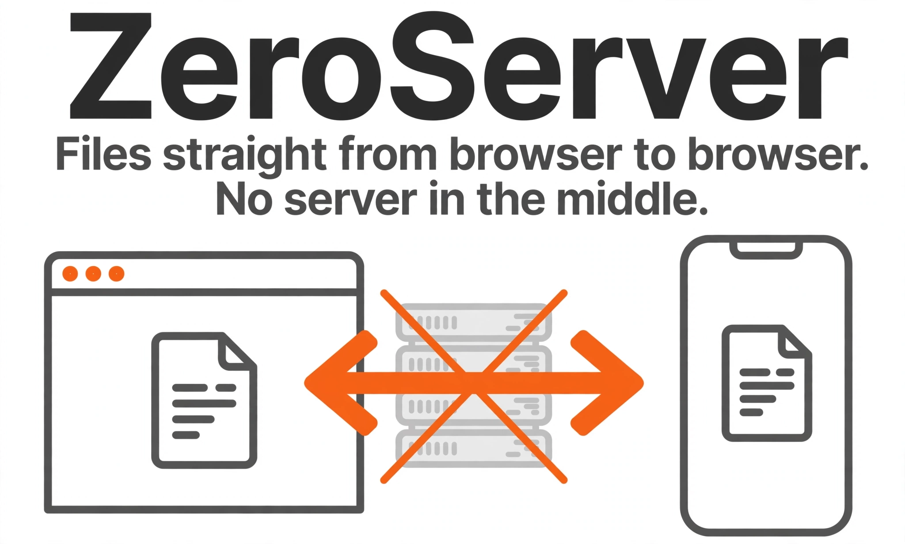

# ZeroServer

Kirim file langsung dari browser ke browser. Tanpa server file, tanpa akun, tanpa batas ukuran dari layanan.

Send files directly from one browser to another. No file server, no account, no size cap set by any service. (English summary below.)

[Live site](https://ptraaah.github.io/zeroserver/) · [Download the latest release](https://github.com/Ptraaah/zeroserver/releases) · [Support on Trakteer](https://trakteer.id/adel_putra2)

## What it is

ZeroServer does the job people know from WeTransfer — pick files, share one link, the other side downloads — with the opposite architecture: there is no server holding your files. The sender opens one web page, picks files, and gets a link and a QR code. The receiver opens the link and the files stream straight from the sender's device to the receiver's device over an encrypted WebRTC data channel.

No account on either side. No upload waiting time — sending starts the moment the receiver accepts. No expiry clock — a link lives exactly as long as the sender keeps the tab open, and the page says so plainly. When the transfer finishes, both sides see a SHA-256 check confirming the received file is byte-for-byte identical to the original.

The interface is Indonesian by default with an English toggle, and it is mobile-first: it is built for low-end Android phones on real-world mobile networks.

## No-server architecture

- The whole product is a single static HTML file. It loads two open-source libraries from a CDN (PeerJS for signalling, qrcode-generator for the QR code) and otherwise runs entirely in the browser.
- PeerJS's public broker introduces the two browsers to each other (signalling only). After that, file data never touches any server: it flows peer-to-peer over a DTLS-encrypted WebRTC data channel, using public STUN servers to find a path. Since v1.3, when no direct path exists, short-lived TURN credentials minted by a small worker let the connection relay through Cloudflare instead of failing; the relay forwards the same encrypted traffic and cannot read it.
- Files are sent in 256 KB chunks with flow control. The receiver hashes every chunk as it arrives, so the final integrity check covers the exact bytes received.
- On Chrome and Android, received files stream straight to disk through the File System Access API. Browsers without it (Firefox, Safari) stream into the browser's origin-private on-device storage (OPFS) instead and offer the finished file as a download; only when neither API exists is a file held in memory.
- The page includes a small connection-test panel: it shows whether the connection ran direct or via relay, how much moved, at what speed, and copies a plain-text result you can share for debugging.

## Self-host in one step

Copy `index.html` to any static host — GitHub Pages, Cloudflare Pages, Netlify, a plain web server, even a USB stick served locally. There is nothing to install, no build step, no backend, no database. That is the whole deployment.

## The pledge

ZeroServer will never add accounts, ads, or features locked behind a paywall. It does not need to: there is no server to pay for. And because the whole tool is one file that anyone can copy, you own it outright — even if this page disappears tomorrow, every copy already out there keeps working forever.

## How a transfer works

1. The sender picks one or more files — or a whole folder — and presses "Buat link kirim" (Create send link).
2. The page creates a one-time peer ID and shows a link plus QR code. The sender shares the link, e.g. via WhatsApp — the pre-composed message reminds both sides to keep their pages open. Optionally, the sender can protect the link with a 4-digit PIN, make it one-shot (dead after the first completed transfer), or let it expire 30 minutes after creation.
3. The receiver opens the link, sees the file list and total size, and presses "Terima file" (Accept files). If the browser supports it, they pick where each file should be saved.
4. Files stream device-to-device with progress, speed, and time remaining shown on both sides. While a transfer runs, the page uses the Wake Lock API to keep the screen on, so a phone falling asleep does not cut the transfer.
5. Each file is verified with SHA-256 at the end. A green badge means the copy is identical to the original.
6. If the connection drops mid-transfer, the receiver can reconnect to the same link. Files that already passed verification are skipped, and on browsers that save the file to disk (Chrome's save picker, or the built-in OPFS storage) the interrupted file itself continues from the last chunk that safely landed: the stored part is re-read and re-checked against the running hash before anything new is accepted, and the final whole-file hash still has the last word. Only on browsers that can merely hold a file in memory does the interrupted file start over. Short hiccups do not end a transfer at all - the page waits them out for up to 30 seconds and shows "reconnecting" while it does.
7. When everything arrives verified, the receiver gets a one-tap button to send a short "done, complete and verified" message back to the sender on WhatsApp.

## Sending big files on the same Wi-Fi

This is the case ZeroServer is built to be fastest in: two devices on one network, nothing uploaded anywhere, the file crosses at whatever the Wi-Fi can carry. Rough wall-clock times for one big file at three common local speeds:

| File | 100 Mbps | 300 Mbps | 600 Mbps |
| --- | --- | --- | --- |
| 10 GB | about 13 min | about 4.5 min | about 2.2 min |
| 50 GB | about 1 h 7 min | about 22 min | about 11 min |
| 100 GB | about 2 h 13 min | about 44 min | about 22 min |

Those are wire-speed numbers. A tired router, distance from it, or a phone busy doing something else adds time on top. After one real run, the test panel on your device remembers the best sustained send and receive speeds it has seen, so you can quote your own network's number instead of this table's.

Three things to keep in mind before a long haul:

- **Both ends need the room.** The receiving device ends up storing the whole file, so check its free space first. On browsers that save into their own storage area, ZeroServer now estimates the space before anything moves: it warns when things look tight, and refuses up front when a file plainly cannot fit, instead of dying near the end.
- **The sender stays open the whole time.** The sender tab is the server. A two-hour transfer means two hours with that tab open and the device awake — the page holds the screen on while a transfer runs, but it cannot survive the tab being closed.
- **Across the internet, the upload speed is the ceiling.** The same 10 GB over a typical 20 Mbps home upload takes about 67 minutes, and 100 GB takes about 11 hours, no matter how fast the Wi-Fi on either end is. Big files are a same-network game; across networks, send while you are on a call and let it take the time it takes.

## Known limits

- **The sender must stay online.** There is no store-and-forward: if the sender closes the tab or loses connection, the transfer stops. ZeroServer is a live handoff tool — best while you are on a chat or call with the other person.
- **Some networks still will not connect.** Since v1.3 a TURN relay catches most connections that cannot go direct (strict NAT, carrier CGNAT), but the relay runs on a free quota with a hard ceiling: if it is ever exhausted or unreachable, ZeroServer falls back to direct-only rather than running up a bill, and a few very strict firewalls can still block everything. If a connection fails, try another network (e.g. switch between mobile data and Wi-Fi).
- **Large files outside Chrome need care.** Without the File System Access API, ZeroServer streams into OPFS on-device storage where that exists (Firefox), so big files no longer sit in RAM. Only browsers with neither API hold incoming files in memory, and there a file over roughly 300 MB can crash the tab. For the biggest files, receive in Chrome on Android or desktop Chrome.
- One receiver per link in v1, and no transfer history or accounts — by design.

## Run a connection test

1. Open the page on device A, pick a test file, create a link.
2. Open the link on device B (a different network is the interesting case: mobile data vs home Wi-Fi, different carriers, etc.) and accept.
3. When the transfer finishes, press "Salin hasil tes" (Copy test result) on either device.
4. Paste the copied summary wherever test results are collected. It contains the time, the device role, whether the path was direct or relayed, browser, total size, duration, average speed, and the result — everything needed to judge how well connections work on real networks.

## Licence

MIT — see [LICENSE](LICENSE). Copyright (c) ptraaa.

---

### English summary

ZeroServer is a single-file, open-source web page for sending files directly between two browsers over WebRTC. No file server, no accounts, no service-imposed size cap, and an end-to-end SHA-256 integrity check on every file. The sender must stay online during the transfer; a TURN relay (since v1.3) catches most networks that cannot connect directly, but a few strict firewalls can still block a connection; Chrome/Android is the best-supported receiving browser for very large files. Self-hosting is copying one HTML file to any static host.

## Changelog

**v1.5** — Built around a real failure: a 67 MB phone-to-phone send over one Wi-Fi that slowed down and died at 71%. Three fixes came straight out of it. A signalling hiccup no longer kills a running transfer, because the data channel lives independently of the signalling socket. A paused connection gets a 30-second reconnecting grace window plus a heartbeat, instead of failing at the first wobble. And an interrupted file now resumes from the last chunk that safely landed on disk instead of starting over - the stored part is re-hashed before it is trusted, and the final whole-file hash still decides. Also in this version: the send loop wakes on the channel's own drain event instead of polling on a timer, reads run one chunk ahead of sends, acknowledgements flow twice as often so the pace is set by the network rather than the code, receivers saving into browser storage get a space check before the first byte (a loud warning when it looks tight, an upfront refusal only when a file plainly cannot fit), and the connection test panel remembers the best sustained send and receive speeds the device has ever held.

**v1.4** — The share card now draws a QR code of the send link next to the link itself, generated by a small library built into the page, so a phone nearby can pair with a camera point instead of a paste. While a transfer runs, a live speed and time-left estimate sits under the progress bars on both sides, measured over the last few seconds; after a reconnect the estimate restarts fresh rather than blending the dropped connection back in.

**v1.2** — WhatsApp handoff kit: the share message now carries stay-open notes for both sides, the receiver gets a one-tap "done, complete and verified" message back to the sender, and links opened inside chat-app browsers show a warning with a copy-link button. A same-Wi-Fi badge appears when both devices share a network. Senders can optionally protect a link with a 4-digit PIN, make it one-shot, or let it expire after 30 minutes. A pre-flight network check gives the sender an honest first guess at whether direct connections will work. Receivers on Firefox and Safari now stream into OPFS storage instead of holding files in RAM.

**v1.1** — Wake Lock keeps the screen on during a transfer; send a whole folder at once; Open Graph / Twitter link previews; a "share this tool" button; resume after reconnect — if the connection drops, the receiver can reconnect to the same link and already-verified files are skipped instead of resent.

**v1.0** — First release: one-link peer-to-peer file transfer with per-file SHA-256 verification and a connection-test panel.

---

Also by ptraaa: [Sifu Android Lag Fix](https://github.com/Ptraaah/sifu-android-lag-fix) - a small free app that makes Sifu on Android run lighter on low-end and mid-range phones.
